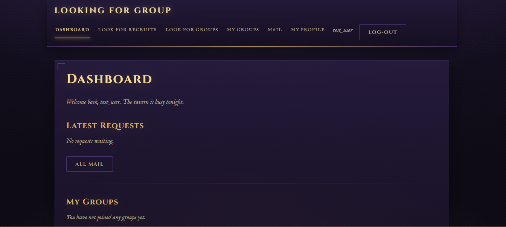
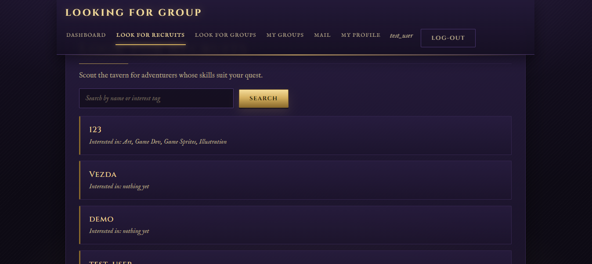
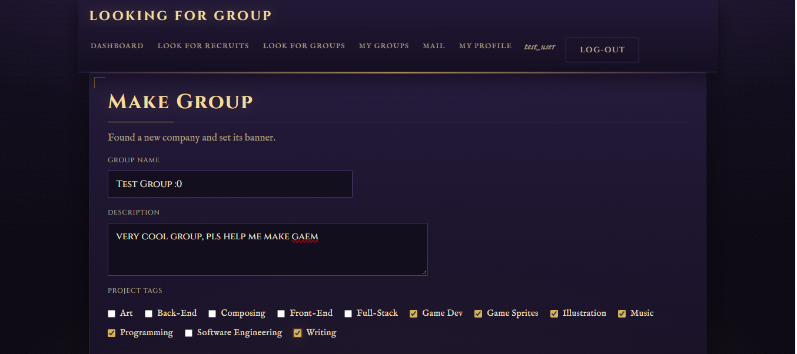

Welcome to LookingForGroup!

My reasons in making this app lies within my love of creative work and working on indie, small-scale passion projects. I find myself lacking the capabilities to make a full game project or a comic or anything the like with my own skills. Say I need a music for my game, I don't have the skill for that. The best way to handle this is to find people who has the same passion, wants to work on a small-scale indie project, and has the time. Finding these people are hard, so I came up with the idea of LookingForGroup, a web-based application that allows YOU and ME to find PEOPLE that wants to work on a project together, simply put. 

How to run:
- Clone this Git Repository to your machine
- An .env.example is provided, first enter the credentials there (JWT token is any string that's hard to guess)
- Run the code by simply running:
docker compose up -d --build 
- Enjoy hosting this sick app

Screenshots:

Article: 

Youtube Video Explanation: 

AI Declaration:
AI was used in the making of this project:
> For overall code, since there isn't enough time to code everything (architecture, ideation, framework and techstack, routing, features, and docker-compose.yaml and Dockerfiles are made by me, the docker files aided by AI when things go south)
> Schema was made by me at first but added into by AI as we get into more features, it added on its own
> The rest (article, video) is made by me solo. 